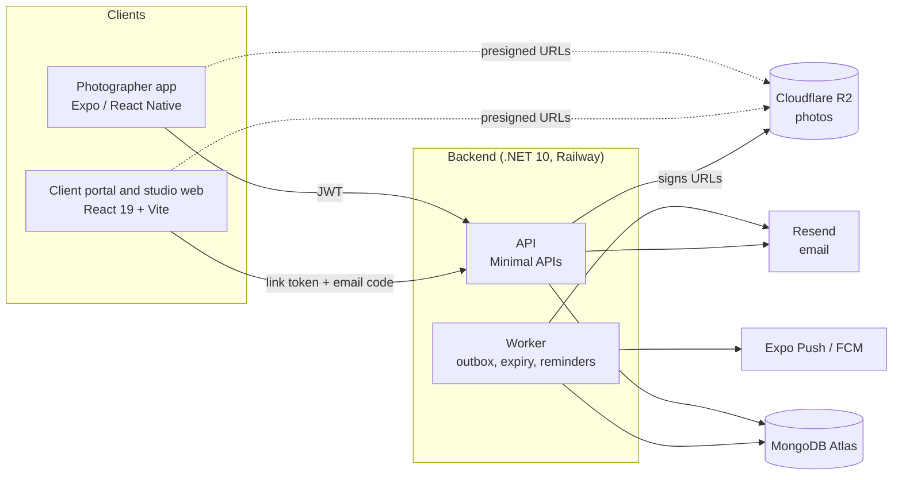
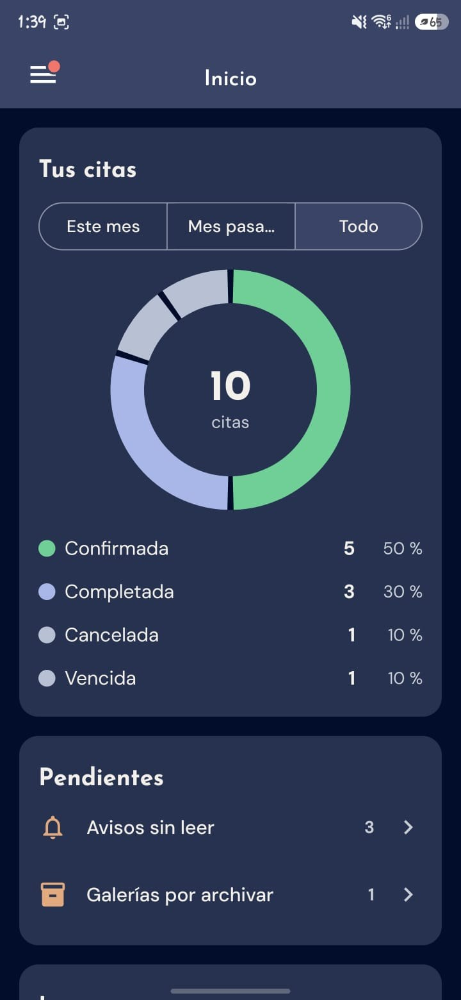
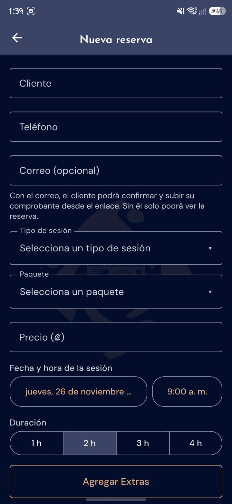
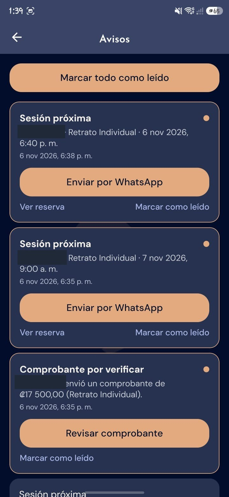
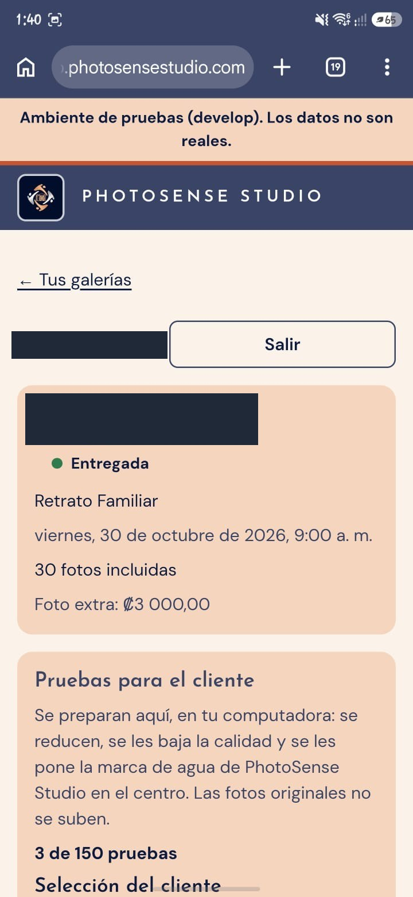
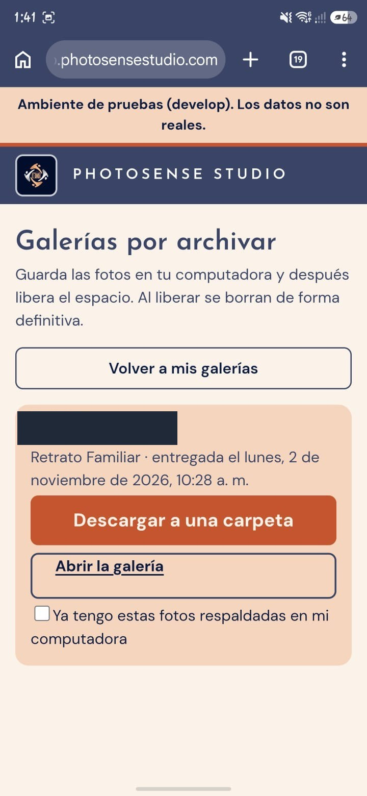

# PhotoSense Studio

**A booking, payment, and gallery-delivery platform for photographers.** One mobile app for the photographer; the client never installs anything and uses a single web link per booking.

> This is the public showcase of a private, commercial project. The source code is not published here. All rights reserved; see [`LICENSE`](LICENSE).

## The problem

Photographers lose money in three places: clients who don't show up, balances that are never collected, and deliveries that drag on. A calendar alone doesn't fix that. PhotoSense Studio treats the booking as a state machine with money attached: a session is only confirmed when the contract is signed and the deposit is verified, and the final photos unlock only when the balance reaches zero.

## How it works

1. A client contacts the photographer (WhatsApp / Instagram).
2. The photographer creates the booking in the app in under 30 seconds.
3. The app generates a unique link and shares it over WhatsApp.
4. On the web portal the client reviews the quote, signs the contract and image release, and pays the deposit (SINPE Móvil with proof of payment).
5. The photographer is notified by push; reminders go out automatically before the session.
6. After the session, the same link shows the proof gallery for selection and the balance. Paying the balance unlocks the final download.

In-person flow: the link is a channel, not a requirement. Contract and payment can be recorded face to face and reach the same state.

## Architecture

Key design decisions:

- **Modular monolith with Clean Architecture** (Domain, Application, Infrastructure, Api, Worker), light CQRS, no microservices.
- **Explicit state machines** for bookings and galleries; clients never implement business rules, they show the `allowedActions` the API returns.
- **Transactional outbox:** each domain event is stored in the same transaction as the change and delivered at least once by the worker to idempotent consumers.
- **Double-booking prevention** with a per-photographer calendar document updated in the same transaction as the booking.
- **Photos never go through the API:** upload and download use presigned R2 URLs; the API only issues the download URL when the balance is zero.
- **Security:** own JWT with rotating single-use refresh tokens (reuse revokes the whole family), hashed secrets, email OTP for clients, per-account and per-address login throttling, tenant isolation on every operation.

## Tech stack

| Area | Technology |
|---|---|
| Backend | .NET 10 (LTS), C#, Minimal APIs, MongoDB (Atlas) |
| Mobile app | Expo SDK 57, React Native, strict TypeScript (no `any`), Expo Router, TanStack Query, Zustand, React Native Paper, Skia |
| Web | React 19, Vite, TypeScript |
| Storage | Cloudflare R2 (presigned URLs) |
| Email and push | Resend; Expo Push over FCM V1 |
| Hosting | Railway (API and worker), Cloudflare Pages (web), MongoDB Atlas |
| CI/CD | GitHub Actions: tests on every pull request, automatic deploy of the develop environment |
| Tests | xUnit v3, NSubstitute, Shouldly; Jest and Testing Library; ESLint |

## Features

- **Bookings:** state machine (tentative, confirmed, completed, cancelled, expired, client absent), reschedule, cancel, packages, extras, discounts.
- **Contracts:** digital signature, remote or in person, with a copy emailed to the client.
- **Payments:** SINPE Móvil proof review, cash, idempotent recording, balance tracking.
- **Billing:** refunds and retentions from the policy frozen on each booking.
- **Gallery:** watermarked proofs, client selection, final delivery unlocked at zero balance, ZIP downloads, archiving.
- **Notifications:** in-app inbox, session reminders, push, WhatsApp messages.
- **Agenda:** calendar-style schedule view in the app.

## Screenshots

Taken from the develop environment with test data (client names are covered).

### Photographer app (Android)

| Home | New booking | Notifications | Gallery archive |
|---|---|---|---|
|  |  |  |  |

### Studio web (light theme)

| Gallery | Archive |
|---|---|
|  |  |

## Status

Backend, mobile app, and web portal are implemented and running in a develop environment. Production launch, iOS builds, and invoicing are pending.

## Contact

For questions or to request access to the source code, open an issue in this repository.
