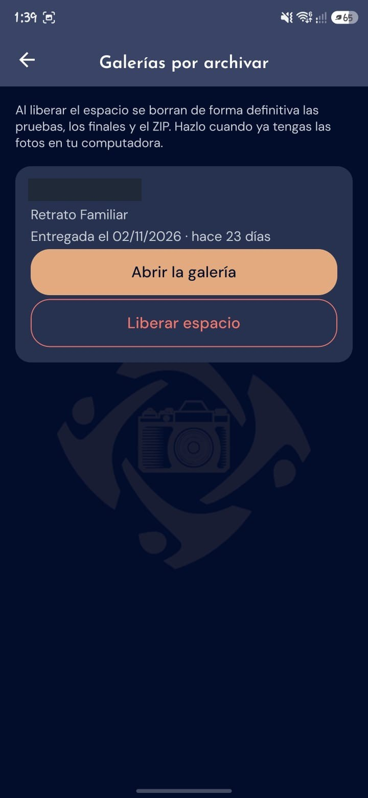
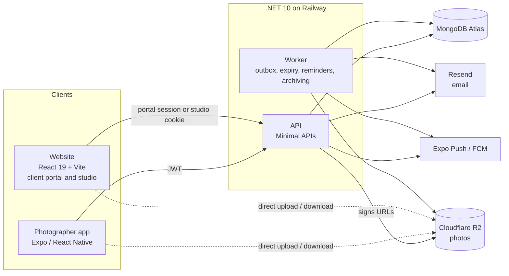
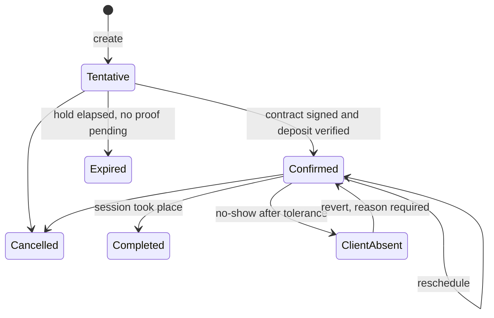
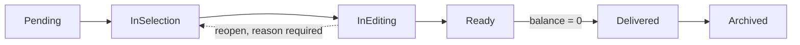

# PhotoSense Studio

**A booking, payment, and gallery-delivery platform for photographers: one mobile app for the photographer, a web link for the client, and one backend behind both.**

> **This is the public showcase of a private, commercial project.** The source code is not published here. All rights reserved; see [`LICENSE`](LICENSE).

## At a glance

| | |
|---|---|
| **Built in** | ~7 weeks of git history (Oct 8 to Nov 25, 2026) |
| **Delivered through** | 113 merged pull requests, 275 commits |
| **Code** | 100,000+ lines of C# and TypeScript across the backend, the mobile app, and the website |
| **Automated tests** | 2,400+ (backend domain, application, integration against a real MongoDB; mobile and web) |
| **API** | 90+ endpoints, three audiences (photographer app, studio web, client portal) |
| **Surfaces** | Android app, client portal, photographer web studio, background worker |
| **Status** | Running in a develop environment; production launch pending |

## The problem

Photographers lose money in three places: clients who don't show up, balances that are never collected, and deliveries that drag on. A calendar alone does not fix any of that.

PhotoSense Studio treats every booking as a **state machine with money attached**. A session is only confirmed once the contract is signed and the deposit is verified; a client who does not show up has their deposit retained according to the policy frozen on the booking; and the final photos unlock only when the balance reaches zero.

The initial market is Costa Rica, so the product speaks Spanish, charges in colones, and supports **SINPE Móvil** (instant bank transfers with a proof of payment).

## How it works

1. A client contacts the photographer (WhatsApp, Instagram).
2. The photographer creates the booking in the app in under 30 seconds.
3. The app generates a unique link for that booking and shares it over WhatsApp.
4. On the web portal the client reviews the quote, signs the contract and image release, and uploads the SINPE proof for the deposit. Nothing to install.
5. The photographer gets a push notification to verify the payment. The app also reminds them 24 hours before each session, with a ready-to-send WhatsApp message for the client.
6. After the session, **the same link** shows the proof gallery for photo selection and the remaining balance. Paying the balance unlocks the final download.

The link is a channel, not a requirement: contract and payment can also be recorded face to face, and the booking reaches exactly the same state.

## Screenshots

Taken from the develop environment with test data (client names are covered).

### Photographer app (Android)

| Home | New booking | Notifications | Gallery archive |
|---|---|---|---|
|  |  |  |  |

### Photographer web studio (light theme)

| Gallery | Archive |
|---|---|
|  |  |

## Architecture

The backend is a **modular monolith with Clean Architecture** (Domain, Application, Infrastructure, Api, Worker) and light CQRS. There are no microservices on purpose: one deployable image runs as the API or as the worker.

### The two state machines

Business rules live only in the domain. Clients never decide what is allowed: they render the `allowedActions` the API returns for each booking.

A completed booking creates its gallery automatically. Delivery is re-evaluated every time a payment is verified, so paying the balance weeks later unlocks the download on its own.

## Engineering highlights

| Concern | Approach |
|---|---|
| **No double bookings** | Each photographer has one calendar document that is updated in the same transaction as the booking, with a conditional write, instead of "check, then insert". |
| **Reliable events** | Transactional outbox: every domain event is stored in the same transaction as the change, then delivered at least once by the worker to idempotent consumers, with leases, exponential backoff, and a failed state for manual review. |
| **Concurrent edits** | Optimistic concurrency with a version field; a lost race returns HTTP 409 instead of overwriting. |
| **Money safety** | Every payment requires an idempotency key (a double tap registers once). Refunds and retentions are computed from the cancellation policy frozen on each booking, so changing the policy later never affects existing bookings. |
| **Photos stay off the API** | Upload and download use presigned Cloudflare R2 URLs. Proofs are resized and watermarked on the photographer's device or browser, so the unedited originals never leave their computer; only the edited finals are uploaded. The API issues the final download address only when the balance is zero. |
| **Authentication** | Own JWT (short-lived access token) with single-use rotating refresh tokens: reusing one revokes the whole session family. Passwords hashed with PBKDF2, refresh tokens and OTP codes stored only as hashes, email verification and password recovery by one-time code. |
| **Web sessions** | The photographer's web studio uses opaque server-side sessions in `HttpOnly`, `SameSite=Strict` cookies, an `Origin` check on every change, and an email code on unrecognized browsers. |
| **Client access** | No accounts for clients: an unguessable per-booking link plus a one-time code sent to the email the photographer registered. |
| **Abuse protection** | Per-endpoint rate limiting, login throttling by account and by address, uniform responses for unknown users, and tenant isolation on every operation (another photographer's resource answers 404). |
| **Mobile type safety** | Strict TypeScript with no `any`; API responses enter as `unknown` and are validated at runtime before being typed. |
| **Operations** | Health checks for liveness and readiness (including MongoDB), structured logging, and configuration only through environment variables. |

## Tech stack

| Area | Technology |
|---|---|
| **Backend** | .NET 10 (LTS), C#, Minimal APIs, MongoDB (Atlas), ASP.NET Core rate limiting and health checks |
| **Mobile app** | Expo SDK 57, React Native, strict TypeScript, Expo Router, TanStack Query, Zustand, React Native Paper (Material Design 3), Skia |
| **Website** | React 19, Vite, TypeScript |
| **Storage** | Cloudflare R2 with presigned URLs |
| **Email and push** | Resend; Expo Push Service over FCM V1 |
| **Hosting** | Railway (API and worker, same Docker image), Cloudflare Pages (website), MongoDB Atlas |
| **CI/CD** | GitHub Actions: build and tests on every pull request, automatic deploy of the develop environment |
| **Testing** | xUnit v3, NSubstitute, Shouldly; Jest and Testing Library; ESLint |

## Features

- **Bookings:** the full state machine, reschedule and cancel with policy rules, packages, extras, and discounts.
- **Agenda:** calendar views for Agenda, Day, 3 days, Week, and Month.
- **Contracts:** digital signature, remote or in person (or a photo of a paper contract), with a copy emailed to the client.
- **Payments:** SINPE Móvil proof review, cash, idempotent recording, and a live balance.
- **Billing:** refunds and retentions for cancelled, expired, and no-show bookings.
- **Gallery:** watermarked proofs, client selection with extra-photo pricing, final delivery unlocked at zero balance, ZIP downloads, and archiving to free storage.
- **Notifications:** an in-app inbox, session reminders, push, and prefilled WhatsApp messages.
- **Accounts:** registration, email verification, password change and recovery, and a separate web studio login.

## Quality and delivery

- **Tests at every layer:** domain rules and state machines, application handlers with substituted ports, repositories and the outbox against a real MongoDB replica set, and the API in memory against real MongoDB.
- **Strict builds:** C# warnings are errors; the mobile app and website pass type checking and lint with `any` forbidden.
- **Pipeline:** pull requests only (no direct pushes to `develop` or `main`); a ruleset requires the CI checks to pass before merging. The CI builds the production Docker image, runs every suite, and skips the jobs whose folder did not change. Merging to `develop` deploys the website, API, and worker automatically.
- **Supply chain:** GitHub Actions pinned by commit SHA, CLI versions pinned, and all secrets kept in the hosting platforms, never in the repository.
- **Documentation:** extensive technical and functional documentation (architecture, data, infrastructure, security, operation, and user guides), kept in sync with the code.

## How it is built: AI-assisted development

Most of this project was implemented with **AI-assisted development using [Claude Code](https://claude.com/claude-code)**. The human role is the product and engineering direction; the assistant does much of the typing.

- **Decisions stay human:** product rules (booking states, deposits, cancellation and refund policies), architecture, the security model, and trade-offs are decided and reviewed by the author before they are implemented.
- **Written rules guide the assistant:** a project instruction file records the architecture, naming, layering, and testing conventions (for example: no `any` in TypeScript, no database types in the domain layer, every public member documented), so the output follows the same standards across sessions.
- **Quality gates, not trust:** every change goes through a pull request and CI (warnings as errors, tests against a real MongoDB, type checking, linting, and the mobile and web suites). Business-rule tests cover the state machines and their edge cases.
- **Reviewed, not pasted:** changes are read, questioned, and corrected; security-sensitive areas (authentication, tokens, rate limiting, tenant isolation) get explicit review and tests.

## Status and roadmap

The backend, the Android app, and the website are implemented and running in a develop environment, and the push notifications were verified on a physical device.

**Next:** production launch, iOS build (pending an Apple Developer account), card payments, Costa Rican electronic invoicing through an authorized provider, Google Calendar sync, and automated WhatsApp messaging.

## Contact

The source code is private. For hiring conversations or a technical walkthrough, reach out through my [GitHub profile](https://github.com/gramirez29), where access to the repository can be arranged on request.
